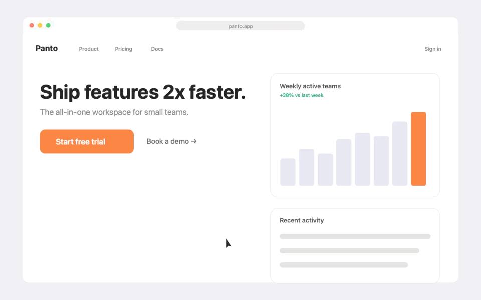

# Panto

**Auto-zoom for your screen recordings.** Free, open source, native macOS.
Every click becomes a camera move, so a boring demo turns into something people actually watch.



<p>


</p>

Screen Studio costs $89. Panto is a small native app that does the one thing most people
open Screen Studio for: smooth zooms on the parts of the screen that matter.

## What it does

- **Records any display** with ScreenCaptureKit, 60 fps, cursor included.
- **Tracks your clicks** and puts a smooth, clamped camera move on each one.
- **Exports an mp4** next to the raw `.mov` — drop it into a tweet, a README or a demo.

No account, no telemetry, no Electron, no 200 MB of Chromium.

## Install

Build from source (Xcode Command Line Tools are enough — a full Xcode install is not required):

```sh
git clone https://github.com/USER/panto.git
cd panto
./scripts/make_app.sh
open build/Panto.app
```

Then grant **Screen Recording** in System Settings → Privacy & Security, and **quit and reopen**
Panto (macOS only applies the permission on the next launch). Accessibility is optional:
with it, Panto zooms on clicks; without it, Panto zooms wherever your pointer rests.

## Use

1. Pick a display, pick a zoom level.
2. Hit the big red button. The window hides itself, recording starts.
3. Click around. Stop from the menu bar.
4. Panto writes `~/Movies/Panto/Panto <date>.mov` and `<date> (zoom).mp4`, then reveals it in Finder.

## How it works

```
ScreenCaptureKit ──► AVAssetWriter (.mov)
        │
        └──► click timeline (CGEvent tap, or pointer-dwell fallback)
                     │
                     ▼
        AVMutableVideoComposition: per-frame affine camera
        (scale from the click timeline, center clamped to the frame,
         pan smoothed with an exponential filter)
                     │
                     ▼
              AVAssetExportSession ──► .mp4
```

The zoom is applied **after** recording, not live: that is why the camera can be smooth,
why it never shows black bars, and why the raw file is always kept.

## Roadmap

- [ ] System audio + microphone
- [ ] Manual zoom timeline (drag the camera, delete a shot)
- [ ] Cursor smoothing and click highlight styles
- [ ] 4K/60 hardware export (HEVC)
- [ ] Global hotkey
- [ ] Signed and notarized releases

## Known limits

- macOS 15+ only (ScreenCaptureKit).
- No audio yet — this is a video-only MVP.
- Release builds are ad-hoc signed until the project has a Developer ID. First launch:
  right-click → Open, or `xattr -dr com.apple.quarantine /Applications/Panto.app`.
- Auto-zoom is click-driven; it does not try to understand what is on screen.

## Development

```sh
swift build -c release          # build the binary
./scripts/make_app.sh           # build Panto.app + icon + ad-hoc signature
./.build/release/Panto --selftest   # synthetic recording → zoom → frames (no permissions needed)
```

`--selftest` renders a fake landing page, applies the camera move and dumps PNG frames.
It is the fastest way to check a change to the zoom math without recording anything.

## License

MIT. Do whatever you want, just keep the copyright notice.
