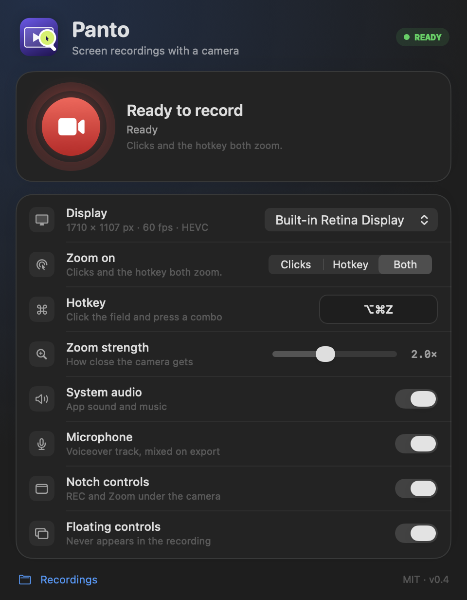

# Panto

**Auto-zoom for your screen recordings.** Free, open source, native macOS.
Every click — or every press of your own hotkey — becomes a camera move.




<p>


</p>

Screen Studio costs $89. Panto does the part people actually use — smooth zooms on the
parts of the screen that matter — and gives you a timeline to fix anything the automation missed.

## What it does

- **Records any display at native resolution** — no downscaling, no soft text. HEVC, ~0.12 bits
  per pixel per frame (≈40 Mbps on a 14" MacBook Pro), 60 fps.
- **Records system audio and your microphone** as separate tracks, mixed on export —
  narrate the demo without losing the app's sound.
- **Zooms three ways**: on clicks, on your own global hotkey (default `⌥⌘Z`), or both.
- **Floating REC bar** with a Zoom button and a Stop button. The app is excluded from the
  capture, so the bar never shows up in the video.
- **Timeline editor**: drag zoom bars, click the preview to place a zoom exactly where you want,
  delete shots, change the zoom strength, export again.
- **Writes an H.264 mp4** next to the raw `.mov`. Nothing is uploaded anywhere.

No account, no telemetry, no Electron, no subscription.

Languages: [简体中文](README.zh-CN.md) · [Русский](README.ru.md)

## Install

**Download** the latest `Panto.dmg` from [Releases](../../releases/latest) and drag it into
Applications. Or let the installer handle everything:

```sh
curl -fsSL https://raw.githubusercontent.com/AbayAtazhan/panto/main/install.sh | bash
```

Panto is not notarized yet, so macOS will refuse the first launch with *"Apple cannot check it
for malicious software"*. The installer clears the quarantine flag; for a manual install run:

```sh
xattr -dr com.apple.quarantine /Applications/Panto.app
```

**From source** — Xcode Command Line Tools are enough, a full Xcode install is not required:

```sh
git clone https://github.com/AbayAtazhan/panto.git
cd panto
./scripts/make_app.sh
open build/Panto.app
```

Grant **Screen Recording** in System Settings → Privacy & Security, then **quit and reopen**
Panto (macOS only applies the permission on the next launch). The microphone asks separately on
the first recording that has voiceover enabled. Accessibility is optional: with it Panto zooms on
clicks; without it, clicks are ignored and you zoom with the hotkey / floating button.

## Use

1. Pick a display, pick how zooms are triggered (clicks, hotkey, both).
2. Hit the red button. The window hides, the floating bar appears.
3. Work. Press `⌥⌘Z` (or the **Zoom** button) whenever the camera should move.
4. Stop. The editor opens with your zooms already on the timeline.
5. Click the preview to add a zoom at the playhead, drag a bar to move it, **Export**.

Files land in `~/Movies/Panto/` — the raw `.mov` is always kept.

## How it works

```
ScreenCaptureKit ──► AVAssetWriter (HEVC .mov, native pixels)
        │                └── audio stream ──► AAC 48 kHz
        │
        ├──► click timeline (CGEvent tap, or pointer-dwell fallback)
        └──► manual zooms (Carbon hotkey / floating HUD)
                     │
                     ▼
        Timeline editor (drag, add, delete)
                     │
                     ▼
        AVMutableVideoComposition: per-frame affine camera
        (scale from the shots, center clamped to the frame,
         pan smoothed with an exponential filter)
                     │
                     ▼
              AVAssetExportSession ──► .mp4
```

The zoom is baked in **after** recording, not live. That is what makes the camera smooth,
keeps it inside the frame, and lets you edit every move before exporting.

## Roadmap

- [ ] Cursor smoothing and click highlight styles
- [ ] Manual zoom strength per shot
- [ ] Record multiple displays at once
- [ ] Signed and notarized builds (Developer ID)
- [ ] Global "pause recording" hotkey

## Known limits

- macOS 15+ only (ScreenCaptureKit).
- No microphone yet — system audio only.
- Release builds are ad-hoc signed until the project has a Developer ID. First launch:
  right-click → Open, or `xattr -dr com.apple.quarantine /Applications/Panto.app`.
- The camera follows clicks/hotkeys; it does not understand what is on screen.

## Troubleshooting

**"I allowed Screen Recording, but Panto still says it is off."**

Local builds are ad-hoc signed. macOS stores the Screen Recording grant against the binary's
**code hash**, and every rebuild produces a new hash — so the grant ends up attached to a binary
that no longer exists. The System Settings toggle may still look enabled while capture is denied
(the system log says `Failed to match existing code requirement ... kTCCServiceScreenCapture`).

Panto detects this: `make_app.sh` clears the stale entry when the hash changes, and the app shows
a **Fix** button. To recover:

1. Press Record → the system asks again → **Open System Settings** → enable Panto.
2. Quit Panto and open it again (macOS applies the grant on the next launch).
3. Still stuck? Run `./scripts/reset_permissions.sh`, then repeat.

System audio is covered by the same permission (macOS calls it "Screen & System Audio Recording").
For a grant that survives rebuilds, run `./scripts/setup_signing.sh` once (it creates and trusts a
local "Panto Dev" certificate, macOS asks for your password once). After that `make_app.sh` signs
every build with it automatically, the designated requirement stays
`identifier "app.panto.recorder" and certificate leaf = H"…"`, and the permission stops resetting.

## Development

```sh
swift build -c release                # build the binary
./scripts/make_app.sh                 # build Panto.app + icon + ad-hoc signature
./.build/release/Panto --selftest     # synthetic recording → zoom → PNG frames
```

`--selftest` renders a fake landing page, applies the camera move and dumps frames — the fastest
way to check a change to the zoom math without recording anything or granting permissions.

## Contributing

Bug reports, pull requests and README translations are welcome — see
[CONTRIBUTING.md](CONTRIBUTING.md). Good first issues are labelled in the tracker,
security reports go through [SECURITY.md](SECURITY.md).

## Architecture

The capture → timeline → camera → export pipeline, the TCC/signing story and the release
tooling are documented in [docs/architecture.md](docs/architecture.md).

## License

MIT. Do whatever you want, just keep the copyright notice.
